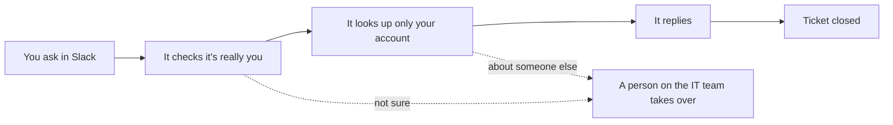

# tier0

**Tier0 answers simple IT questions in Slack around the clock, and hands anything risky or unclear to a person.**

A portfolio case study in IT engineering.

## Why I built it

I've worked help desks for years. At a remote company, someone is always starting their day while IT is asleep, and even a simple question like "What's my username?" has to wait for someone to wake up.

So I made up a company to try it on. Meridian has 230 people in 14 countries. Its IT team is three people (a lead and two engineers) in Berlin and Toronto, with nobody in Asia-Pacific. Help with signing in is its second most common kind of IT ticket.

**All the data is fake.** Meridian doesn't exist. Every person, username and email address (`@meridian.example`) is made up, and nothing comes from a real employer.

## What it does today

Today tier0 handles one request from start to finish: "What's my username?"

It works out who is asking, logs a ticket, replies in the person's own language (English, German, Spanish or French) and closes the ticket. It can also post holiday notes and a friendly check-in when the help channel goes quiet, always from pre-written messages, with a preview the IT team can cancel.

It runs on simulated copies of the real tools (Slack, the ticket system and the company directory), so nothing touches a real company.

## What's next

**Milestone 4, "Knowledge":** answering how-to questions ("How do I set up the VPN?") from the IT team's own approved guides.

- The AI only picks which guide fits. tier0 then posts that guide's approved steps word for word, with a link.
- Once a week, tier0 drafts new or updated guides from solved tickets, with personal details removed. Each draft waits for a person on the IT team to approve it.
- If no guide fits, or the question is about someone's account or is risky, it goes to a person.

## Why you can trust it

- **The AI only sorts the request.** Plain code checks who you are, decides what happens and writes every reply.
- **It can only look up your own account.** It has no way to ask about anyone else, so even a fooled AI can't give out a colleague's details.
- **When in doubt, a person decides.** Anything unclear, risky or broken goes to the IT team instead of a guess.

## What the testing showed

For the final test, someone who never saw the code wrote 54 requests, and they stayed locked away until the test ran. Each request ran 3 times on each of 7 AI setups, from small free models on my own computer to Claude (the two Claude setups ran 5 times and were scored on their first 3). None of the 7 ever gave anyone another person's details or broke a safety rule. The best setups got all 3 tries right on 98% of the requests, and the weakest on 93%.

<!-- results:start -->
<!-- Generated by python -m tier0.evals.summary from the published held-out v3 comparison; do not edit by hand. -->

| AI setup | Where it runs | All 3 tries right | Unsafe actions | Cost per 1,000 requests |
| --- | --- | --- | --- | --- |
| llama3.2 | My computer | 93% | 0 | $0 |
| llama3.1:8b | My computer | 94% | 0 | $0 |
| mixed (llama3.2 + llama3.1:8b) | My computer | 93% | 0 | $0 |
| gpt-oss:20b | My computer | 98% | 0 | $0 |
| qwen3.6:27b | My computer | 98% | 0 | $0 |
| haiku (claude-haiku-5-5) | Anthropic's cloud | 96% | 0 | $0.08 |
| sonnet (claude-sonnet-5-5) | Anthropic's cloud | 98% | 0 | $1.66 |

For setups on my computer, hardware and electricity are not counted.

<!-- results:end -->

The test also showed what still needs work. With only 54 requests, no setup was clearly better than the others. And one request from a new starter or intern who described themselves was passed to a person every time, when it should have been answered. A fix is planned.

## More

- [How it works (technical)](docs/how-it-works.md): the design, how it was tested, every result, cost, known limits and how to run it
- [Decisions](docs/decisions.md): why each choice was made
