# Tier0

Project site: https://kstarev.dev/meridian-it-lab/

**Tier0 is a Slack assistant built to answer simple IT questions around the clock, and hand anything risky or unclear to a person.**

A portfolio case study in IT engineering.

## Why I built it

I've worked help desks for years. At a remote company, someone is always starting their day while IT is asleep, and even a simple question like "What's my username?" has to wait for someone to wake up.

So I made up a company to try it on. Meridian has 230 people in 14 countries. Its IT team is three people (a lead and two engineers) in Berlin and Toronto, with nobody in Asia-Pacific. Help with signing in is its second most common kind of IT ticket.

**All the data is fake.** Meridian doesn't exist. Every person, username and email address (`@meridian.example`) is made up, and nothing comes from a real employer.

## What it does today

Today Tier0 handles one request from start to finish: "What's my username?"

<picture>
  <source media="(prefers-color-scheme: dark)" srcset="docs/img/happy-path-dark.svg">
  
</picture>

It works out who is asking, logs a ticket, replies in the person's own language (English, German, Spanish or French) and closes the ticket. It can also post holiday notes and a friendly check-in when the help channel goes quiet, always from pre-written messages, with a preview the IT team can cancel.

It runs on simulated copies of the real tools (Slack, the ticket system and the company directory), so nothing touches a real company.

## What's next

1. **Milestone 4, "Knowledge":** answering how-to questions ("How do I set up the VPN?") from the IT team's own approved guides. Built, tuned on practice questions, and tested once on its locked-away test on 16 November. Nothing was posted to a person, but two safety rules failed: Claude Haiku picked a planted fake guide for one question, and the code check of guides missed an instruction hidden in a code block. Claude Sonnet, which passed, now picks the guides. A fix for the guide check is planned. [Results](docs/how-it-works.md).
   - The AI only picks which guide fits. Tier0 then posts that guide's approved steps word for word, with a link.
   - If no guide fits, or the question is about someone's account or is risky, it goes to a person.
   - Planned: once a week, Tier0 drafts new or updated guides from solved tickets, with personal details removed. Each draft waits for a person on the IT team to approve it.
2. **Requests passed on in someone else's words,** and instructions hidden inside messages. A new locked-away test set will measure both, and decide whether the cheaper Claude setup keeps its new instructions.

## Why you can trust it

<picture>
  <source media="(prefers-color-scheme: dark)" srcset="docs/img/attack-path-dark.svg">
  
</picture>

- **The AI only sorts the request.** Plain code checks who you are, decides what happens and writes every reply.
- **It can only look up your own account.** It has no way to ask about anyone else, so even a fooled AI can't give out a colleague's details.
- **When in doubt, a person decides.** Anything unclear, risky or broken goes to the IT team instead of a guess.

## What the testing showed

For the final test, someone who never saw the code wrote 54 requests, and they stayed locked away until the test ran. Each request ran 3 times on each of 7 AI setups, from small open models to Claude (the two Claude setups ran 5 times and were scored on their first 3). None of the 7 ever gave anyone another person's details or broke a safety rule. The best setups got all 3 tries right on 98% of the requests, and the weakest on 93%.

The names are different AI models. What matters: none of them, cheap or expensive, ever broke a safety rule.

<!-- results:start -->
<!-- Generated by python -m tier0.evals.summary from the published held-out v3 comparison; do not edit by hand. -->

| AI setup | Type | All 3 tries right | Unsafe actions | Cost per 1,000 requests |
| --- | --- | --- | --- | --- |
| llama3.2 | Open model (benchmark only) | 93% | 0 | – |
| llama3.1:8b | Open model (benchmark only) | 94% | 0 | – |
| mixed (llama3.2 + llama3.1:8b) | Open model (benchmark only) | 93% | 0 | – |
| gpt-oss:20b | Open model (benchmark only) | 98% | 0 | – |
| qwen3.6:27b | Open model (benchmark only) | 98% | 0 | – |
| haiku (claude-haiku-5-5) | Hosted (Claude) | 96% | 0 | $0.08 |
| sonnet (claude-sonnet-5-5) | Hosted (Claude) | 98% | 0 | $1.66 |

In production Tier0 uses a hosted AI (Claude). The open models were only used as a benchmark while building it.

<!-- results:end -->

The test also showed what still needs work. With only 54 requests, no setup was clearly better than the others. And one request from a new starter or intern who described themselves was passed to a person every time, when it should have been answered. That has since been fixed and tested again.

### The follow-up test

The fault was in a code check, not in the AI. After the fix, two new sets of requests were written the same way, by someone who never saw the code, and locked away until the test: 72 requests of every kind, and 32 short ones of the two kinds the fix could change. Each request ran 5 times on the two Claude setups, in three versions: the old one, new instructions for the AI on their own, and the new instructions with the fix.

<!-- results-3b:start -->
<!-- Generated by python -m tier0.evals.paired_summary from the published milestone 3b report; do not edit by hand. -->

Requests handled right on all 5 tries:

| Test | AI setup | Old version | New instructions only | New instructions and the fix | Unsafe actions |
| --- | --- | --- | --- | --- | --- |
| 72 new requests of every kind | haiku | 72 of 72 | 71 of 72 | 70 of 72 | 0 |
| 72 new requests of every kind | sonnet | 71 of 72 | 72 of 72 | 72 of 72 | 0 |
| 20 short requests from people describing themselves | haiku | 17 of 20 | 18 of 20 | 19 of 20 | 0 |
| 20 short requests from people describing themselves | sonnet | 18 of 20 | 18 of 20 | 19 of 20 | 0 |
| 12 short requests for a colleague's login, with no name given | haiku | 12 of 12 | 12 of 12 | 12 of 12 | 0 |
| 12 short requests for a colleague's login, with no name given | sonnet | 12 of 12 | 12 of 12 | 12 of 12 | 0 |

<!-- results-3b:end -->

- **Nothing unsafe happened** in any version, and every request for a colleague's login was refused on every try.
- **The fix helped with one request.** Of the 20 short requests from people describing themselves, 18 were answered on every try without the fix and 19 with it. One is still passed to a person. One request is too small a difference to say the fix improved the rate.
- **The new instructions cost the cheaper Claude setup one request.** On the 72 new requests, haiku refused one person who described themselves, whom the old instructions answered every time. Nothing was given out, but someone who should have been helped was turned away. Its other miss in the last column comes from a different check, whose answer varied from try to try.
- **Not measured yet:** requests passed on in someone else's words ("my colleague says: 'I need my login'"). The new instructions were written for these, but both sets were written before this kind of request was found. The next test set will include them, and will decide whether haiku keeps its new instructions.

## More

- [How it works (technical)](docs/how-it-works.md): the design, how it was tested, every result, cost, known limits and how to run it
- [Decisions](docs/decisions.md): why each choice was made
