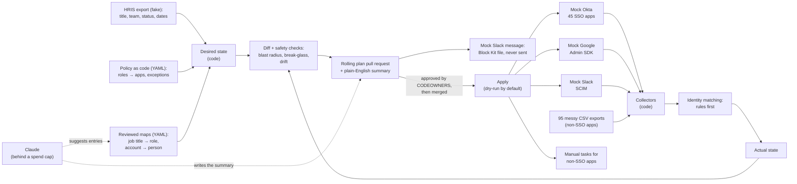

# Access-as-Code: brief

"terraform plan" for people: who should have access to what is written down as code, a bot shows every night what it would change, and a person approves before anything changes.

Project 2 of the Meridian IT lab. Milestone 1 is this brief, the [decisions](docs/adr/README.md) and the [milestone plan](MILESTONES.md). **No code yet.**

**All the data is fake.** Meridian is a made-up company. Every person, account and app export is generated, every email address is `@meridian.example`, and the APIs are mocks shaped like Okta, the Google Admin SDK and Slack. Nothing touches a real tenant, and nothing comes from a real employer.

## The problem

Meridian's IT team is three people. They can't reliably say who has access to what across about 140 SaaS apps: 45 behind Okta single sign-on (SSO) and 95 outside it ([lab brief](../docs/brief.md)). Joiners, movers and leavers (tickets 1, 5, 6 and 8 in the lab's top 10, about 36% of all tickets) are handled from checklists. Access that should have gone stays: an ex-employee's account in an app nobody remembered, or a mover who keeps the old team's tools. Audits then ask for evidence that is put together by hand.

## The story

When Jordan moved from Sales to Marketing, nobody removed the sales CRM. When Sam left, Sam's account in the design tool stayed open for weeks, because that tool isn't behind SSO and the leaver checklist missed it. With Access-as-Code, a bot compares every night what each person should have, based on their job, with what they really have. It then opens one pull request that says in plain English what it would change: "Remove Jordan from the sales CRM (moved to Marketing on 3 March)". Someone on the IT team reads it and approves it, and only then does anything change. If the bot wants to remove a lot at once, for example because the HR system wrongly marked forty people as leavers, it needs two people to approve.

## How it works

- **Desired state** is what each person *should* have. Code builds it from the HRIS record (job title, team, employment type, status, start, end and leave dates) and the policy files: a role's apps, apps everyone gets, and time-limited exceptions that each name an approval.
- **Actual state** is what each person *does* have: Okta app assignments, Google and Slack accounts, and 95 CSV exports from apps without SSO. The exports are messy on purpose: different column names, email addresses in some and usernames in others, and four date formats.
- **The plan** is the difference between the two, as a pull request. One rolling pull request is updated each night, and only when there's something to change. The summary is in its description, and each time the plan changes the bot adds a comment saying what changed ([AAC-002](docs/adr/002-the-plan-is-a-pull-request.md)).
- **Approval** is a pull request review by the code owners. **Apply** happens on merge. It runs idempotent changes against the mock APIs, and it's a dry run unless switched on. Apps without an API get a manual task instead.
- **Drift** is anything changed outside this process, such as an admin role added by hand. It's flagged in the plan pull request.

### The model interprets, code enforces

The AI (hosted Claude, behind a spend cap in code, [AAC-006](docs/adr/006-model-choice-and-spend-cap.md)) does only three things:

1. It suggests a role for a messy job title ("Sr. Acct Exec, EMEA" → `sales-ae`).
2. It suggests which person an unmatched account belongs to, after the rules have matched everything they can.
3. It writes the plain-English summary of a plan that code has already built.

Its suggestions go into the reviewed map files, labelled as AI suggestions, through the same pull request review. No access change depends on a suggestion until a person has approved that map entry. The model never decides access, never sees an API credential and never calls an API ([AAC-007](docs/adr/007-safety-rails.md)).

### Safety rails

- **Nothing changes without a merged, approved plan.** Apply is a dry run by default.
- **Blast-radius limit:** a plan that removes more than N accesses (N = 25 to start, set in the policy) needs two approvers.
- **Break-glass accounts** are on an allowlist. They are never changed, only reported.
- **A stale plan is never applied:** if the actual state changed after the plan was made, apply stops and the plan is made again.
- **Secrets live only in GitHub Actions secrets.** Everything runs on GitHub (Actions, scheduled workflows), nothing on a laptop. There's no real Slack: a mock adapter builds the Slack message and saves it as a file, and nothing is ever sent ([AAC-008](docs/adr/008-runs-on-github-only.md)).

## Metrics and targets

Scored on a sealed held-out world, with the tuning world's numbers reported beside it ([AAC-005](docs/adr/005-sealed-answer-key.md)).

| Metric | Target |
|---|---|
| Precision and recall on planted problems, per problem type (held-out) | ≥ 0.90 each |
| Unsafe changes: any change to a break-glass account, any change without a merged plan, a removal over the blast-radius limit without two approvals, a removal that rests on an unreviewed AI match | 0 |
| API calls made by the model | 0 |
| Same plan applied twice: changes on the second run | 0 |
| Same seed produces the same plan | Always |
| Identity matching, rules only vs rules + AI: precision and recall on account-to-person matches | Both reported; rules + AI precision ≥ 0.95 |
| Job title to role suggestions: accuracy against the answer key | Reported |
| Time to a leaver's full deprovisioning plan ([lab brief](../docs/brief.md)) | < 5 min |
| Claude spend | Never above the cap; cost per nightly run reported |

Every number on the results page is generated from published reports and checked by a test, as tier0's are (`test_site_numbers.py`).

**Final scoring rule.** The held-out world is scored once, at the end ([AAC-010](docs/adr/010-human-rulings-before-publishing.md)).

- **A human rules on every disagreement before anything is published.** Every disagreement between Access-as-Code and the answer key goes to the repo owner for a ruling. This covers a finding the tool missed, a finding the key doesn't have, and a different action for the same account.
- **Each ruling is logged** in `docs/evals/<date>-access-held-out-a1-rulings.md`: the item, what the tool did, what the key says, the ruling and why.
- **Key errors are reported as key errors.** A disagreement ruled a key error doesn't count against the tool, and the report lists key errors separately, with their count.
- **Nothing is re-run.** The rulings don't change the tool or re-run it.

## Honest limits

- **Mocks are not the real APIs.** They copy the shape of Okta, the Google Admin SDK and Slack SCIM, including pagination, rate limits and errors, but real tenants have quirks the mocks won't.
- **We planted the problems ourselves.** The held-out recipe is written blind and sealed, but it comes from the same family of ideas, and real exports are messier than ours.
- **What the sealed world can and can't test.** It can bring mess the practice world never had (new column names, date formats, name spellings, username patterns and HR edge cases), but only within the generator's fixed list of systems, fields and problem types, so a kind of problem nobody thought to describe can't appear in it.
- **The answer key and the system share an author.** The same builder writes the generator that makes the answer key and Access-as-Code itself, so one misreading of the rules could end up in both and look like agreement. The blind referee, a script written by a helper who has seen neither and that builds its own key from the raw held-out files, is the check against those shared mistakes ([AAC-011](docs/adr/011-blind-referee-against-shared-mistakes.md)).
- **Small numbers.** The tuning world has 23 orphaned accounts and 11 movers. Counts like that give wide intervals, and they're reported with them.
- **One person stands in for the IT team.** The two-approver rule needs a second reviewer; in the lab that's a second GitHub account or a scripted stand-in, said plainly wherever it's used.
- **Non-SSO apps can't be changed by API.** For those, the plan creates a manual task and can only check the next export.
- **The nightly demo runs on the tuning world,** never the held-out one, so what's public each night is never the scored test.
- **The model isn't deterministic.** Suggestions can differ between runs, which is one reason they need a review before they count.
- **Compliance notes are a mapping, not a claim of compliance**, and not legal advice.

## Compliance mapping

A mapping, not a claim of compliance.

| Framework | Control | How the design maps to it |
|---|---|---|
| SOC 2 | CC6.1, logical access | Access is defined as code, and every change goes through a reviewed pull request with an audit trail. |
| SOC 2 | CC6.2, registration and removal | Joiners get access from their HRIS record, and leavers' access is in the next plan. Accounts with no owner are flagged. |
| SOC 2 | CC6.3, role-based access and changes | Roles map to apps in policy. Movers' old access is removed, and exceptions expire. |
| ISO 27001:2022 | A.5.15, access control | Policy as code is the written access rule, and it's enforced by the diff. |
| ISO 27001:2022 | A.5.16, identity management | Accounts are matched to people, duplicates and orphans are flagged, and rehires are handled explicitly. |
| ISO 27001:2022 | A.5.17, authentication information | Not covered: Access-as-Code doesn't handle passwords or MFA. |
| ISO 27001:2022 | A.5.18, access rights | Granting, review and removal go through plan pull requests, and merged plans are the review record. |

## In scope

- One seeded fake world for Access-as-Code: 230 people, an HRIS timeline over a simulated month, Okta, Google, Slack and 95 CSV exports, planted problems and an answer key ([AAC-004](docs/adr/004-extend-the-shared-dataset.md))
- Policy as code, desired state, collectors, identity matching, the diff, the plan pull request with its summary and change comments, a mock Slack message (built and tested, never sent), apply against mocks, drift detection and the blast-radius check
- A sealed held-out world and a results page

## Out of scope

- Real tenants, real HR systems and real employer data
- Passwords, MFA and device management
- Applying changes to real systems
- Real Slack: no workspace, token or webhook
- A UI beyond the pull request and static pages
