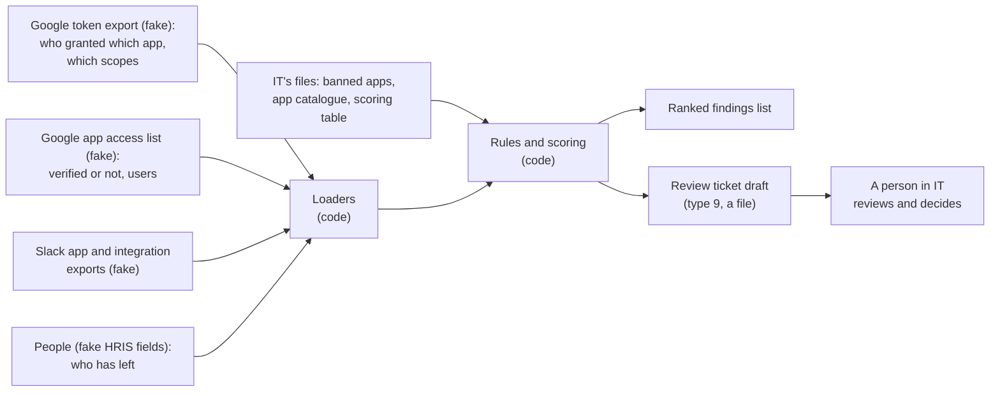

# Shadow AI Radar (oauth-radar): brief

A radar for "shadow AI": it finds the third-party apps, AI tools above all, that people at Meridian have let into company data without IT's review, ranks them by risk, and drafts a review for a person in IT. It never revokes anything by itself.

Project 3 of the Meridian IT lab. Milestone 0 is this brief, the [decisions](docs/adr/README.md), the [milestone plan](MILESTONES.md) and a small scaffold: the data model, a loader for one export shape, two rules and a command line, tested on hand-written fake files. **No generated data yet, and no AI.**

**All the data is fake.** Meridian is a made-up company. Every person and email address is `@meridian.example`, every app name is invented, and every file is shaped like an export from Google Workspace or Slack without coming from one. Nothing touches a real tenant, and nothing comes from a real employer.

**Where this brief comes from.** There is no separate catalogue document for this project. This brief is built only from what the repo already says about `oauth-radar`:

- the [lab brief](../docs/brief.md): ticket type 9, "New app or integration approval" (4% of tickets, owned by oauth-radar), the metric "High-risk OAuth grants found: 100%", the in-scope list, the fact sheet, and the security and compliance stance;
- the [lab decisions](../docs/decisions.md): ADR-001 (one shared dataset with planted problems, risky grants among them, measured by precision and recall), ADR-003 (grade by final state), ADR-013 and ADR-029 (held-out sets written blind and sealed), ADR-037 (no Claude budget for this project);
- [Access-as-Code](../access/BRIEF.md), as the model for a project's own brief, milestones and decisions.

**If a catalogue or a longer description of this project exists anywhere else, the owner should point to it,** and this brief will be checked against it.

**Update, 2026-11-19: the owner's catalogue exists.** Where it differs from this brief or from OAR-001 to OAR-007, the catalogue wins, since none of them is accepted yet. Every difference, and what milestone 1 does about it, is in [catalogue-differences.md](docs/catalogue-differences.md).

## The problem

"Shadow AI" is what happens when people give a third-party app, often an AI tool, access to company data without IT ever seeing it. A meeting note-taker asks to read every calendar and every Drive file. A writing assistant asks for full Gmail. An AI agent asks to read every Slack channel. Each takes one click on "Allow" (an OAuth consent), and from then on the app holds a token that reaches that data until someone takes it back.

Meridian's IT team is three people, and Meridian has about 140 SaaS apps ([lab brief](../docs/brief.md)). Ticket type 9, "New app or integration approval", is how an app is meant to get reviewed. It's only 4% of tickets, because most apps never go through it: people just click "Allow". So IT can't say which apps hold which grants, how many people use them, or which of them can read everyone's mail. The audits Meridian goes through (SOC 2 Type II, ISO 27001) ask exactly that.

## Who it's for

- **Meridian's IT team** (a lead and two engineers, in Berlin and Toronto). They get one ranked list to work from, worst first, with the reason for each line.
- **Whoever answers the auditors.** The list is evidence that third-party access is watched.
- **People at Meridian.** A finding opens a review, not a block. Nobody loses a tool because a rule fired.
- **Readers of this portfolio,** who want to see how an IT engineer would find and rank risky grants, and how it's tested honestly.

## The story

Priya joins a call that a sales prospect set up with an AI note-taker. Afterwards the note-taker offers to "keep your notes in sync", and she clicks Allow. It now holds a grant that reads her calendar and every file in her Drive. Two weeks later Sam, who has left Meridian, still has a grant to the same app, and so do 27 other people. With the radar, the next export shows all of it: one app, 29 grants, unverified publisher, AI, full Drive. It's first on the list, and the radar drafts one review ticket for it. Someone in IT reads it, checks the app, and decides. The radar doesn't revoke anything itself.

## How it works

Planned design. Milestone 0 builds only the first loader (the Google token export), two rules and the ranked list.

### What it reads

Files only, offline, shaped like real exports ([OAR-005](docs/adr/005-offline-export-shaped-files.md)):

- **Google Workspace:** a token export shaped like the Admin SDK's `tokens.list` (who granted which app which scopes), and the admin console's list of accessed apps (verified or not, how many users, trusted or blocked).
- **Slack:** integration logs shaped like `team.integrationLogs` (who added which app with which scopes, and when), and the admin list of approved and restricted apps.
- **People:** a few HRIS fields from the shared dataset (work email, status, end date), so a grant held by someone who has left can be found.
- **IT's own files:** the banned-app list, the app catalogue (which apps are reviewed, which are AI) and the scoring table.

### What it finds

The planted problems in the dataset, each one high-risk ([OAR-002](docs/adr/002-risk-model-rules-first.md)):

| Type | Example | Why it's risky |
|---|---|---|
| `broad_scope` | Full Drive or full Gmail access | The app reaches every file or every email the person can see |
| `unverified_publisher` | An app Google hasn't verified, or a Slack app outside the App Directory, that IT never reviewed and that asks for more than sign-in | Nobody has checked who is behind it |
| `ai_app_org_wide` | An AI note-taker installed for everyone, or granted by 25 people or more, holding more than sign-in scopes | One app reaches a large share of the company's data |
| `leaver_grant` | A grant still live, with more than sign-in scopes, for someone HR says has left | Company data still flows to an app on behalf of someone who's gone |
| `banned_app` | A grant to an app IT has banned | It's already been judged unsafe |

The dataset also plants decoys that look alike but aren't high-risk, such as "Sign in with Google" apps or an AI app that only sees files it made, so precision means something.

### How it scores

Rules, not a model. Each grant gets points for the broadest scope it holds and the data that reaches, an unverified publisher, how many people use the app, whether it's an AI app, and whether IT has reviewed it at all. A banned app or a leaver's grant is high whatever the points. Five points or more is high. The table, the worked examples and the reasons for rules first are in [OAR-002](docs/adr/002-risk-model-rules-first.md). In milestone 0 only two rules exist: `broad_scope` and `banned_app`.

### What it outputs

- **A ranked findings list:** each grant, its tier and score, and every rule that fired, in one plain sentence each, worst first. The same input always gives the same list.
- **A review ticket draft** (milestone 2): one per app, shaped like a Linear issue of type 9, "New app or integration approval", opened after the fact. It lists who granted what, why it was flagged, and the questions IT should ask. It's a file. Nothing is filed or sent.

### What it never does

- **It never revokes, blocks or changes a grant** ([OAR-004](docs/adr/004-read-only-never-revoke.md)). A finding can only ask for a review. The data model refuses any other action, and a test fails if the code names anything that revokes or deletes.
- **It never calls a real API** and holds no credentials. It imports no network library ([OAR-005](docs/adr/005-offline-export-shaped-files.md)).
- **It never reads message or file content.** Every input is metadata: who, which app, which scopes, when. When a scope lets an app read every message, the finding says so. The radar never reads one.
- **It makes no AI call** in milestones 0 to 3, and spends nothing ([OAR-007](docs/adr/007-rules-decide-ai-explainer-later.md)).

## Metrics and targets

Scored once on a sealed held-out world, with the practice world's numbers beside it ([OAR-006](docs/adr/006-practice-and-sealed-held-out-worlds.md)).

| Metric | Target |
|---|---|
| High-risk OAuth grants found: recall on planted high-risk grants ([lab brief](../docs/brief.md)) | 100% |
| Precision: grants marked high that the answer key lists as high-risk | Reported; the lab's target for every project is ≥ 0.90 |
| Recall and precision per problem type | Reported |
| Grants revoked or changed by the radar | 0 |
| API calls and AI calls | 0 |
| Same input, same findings | Always |

Each rate comes with its count and a 95% interval. Every number on a results page will come from a published report and be checked by a test, as tier0's are.

## How it's tested

- **Now (milestone 0):** unit tests on hand-written fake fixtures in `oauth-radar/tests/fixtures/`, in the lab's root test run and CI. The lab's test-wide guard blocks the network.
- **A practice world** (milestone 1): OAuth grants generated into the shared dataset, for the people of the Access-as-Code world, without moving any existing world ([OAR-003](docs/adr/003-grants-enter-the-shared-dataset.md)). The rules and the scoring table are tuned on it.
- **A held-out world** (milestone 3): written blind by a helper who has never seen the rules, sealed by hash, and scored once with everything frozen. The owner rules on every disagreement before any number is published. Then it becomes a dev set, like tier0's and Access-as-Code's.

## Honest limits

- **The exports are shaped like the real ones, not copied from them.** Real admin consoles have extra fields, paging and quirks these files won't.
- **We plant the problems ourselves.** The held-out world is written blind, but from the same list of problem types and file shapes, so a kind of risk nobody described can't appear in it.
- **The key and the radar share a builder,** so one misreading could end up in both and look like agreement. Whether a blind referee is needed, as Access-as-Code added, is the owner's call in milestone 3.
- **An export is a snapshot.** A grant made and taken back between two exports is never seen.
- **A scope says what an app may reach, not what it took.** The radar can't see data that already left.
- **AI apps are known from the vendor directory's AI flag, and a short word list for apps it doesn't know** ([OAR-008](docs/adr/008-risk-rubric-with-the-owners-changes.md)). A new AI app with a plain name, unknown to the directory and with narrow scopes, scores low. "Not reviewed" points and "an unknown scope counts as broad" are the safety nets.
- **Small numbers.** 100% of 20 planted grants still has a 95% interval that starts at about 84%. The report shows both.
- **Compliance notes are a mapping, not a claim of compliance**, and not legal advice.

## Compliance mapping

A mapping, not a claim of compliance, in the style of the lab's [compliance](../docs/compliance.md) and [security](../docs/security.md) pages.

| Framework | Control | How the design maps to it |
|---|---|---|
| SOC 2 | CC6.1, logical access | Third-party apps holding grants to company data are listed and ranked, so access through them is visible and reviewed. |
| SOC 2 | CC6.2 and CC6.3, granting and removing access | Grants held by people who have left are always high-risk, and every finding opens a review a person decides. |
| SOC 2 | CC7.2, monitoring for anomalies | Each new export is scanned, and new broad, unverified or banned grants come out at the top. |
| SOC 2 | CC9.2, vendor and business partner risk | Unverified publishers and apps IT never reviewed are scored up, and the ticket draft lists the questions IT should put to the vendor. |
| ISO 27001:2022 | A.5.9, inventory of information and other associated assets | The findings list is an inventory of third-party apps with access, and who granted it. |
| ISO 27001:2022 | A.5.19 and A.5.23, supplier relationships and use of cloud services | Apps that reach company data without review are found and sent through review. |
| ISO 27001:2022 | A.5.10, acceptable use | IT's banned-app list is checked by a rule that always flags. |
| ISO 27001:2022 | A.8.16, monitoring activities | The scan is a repeatable check over each export. |
| EU | GDPR | **Minimisation:** the radar reads grant metadata only, never message or file content. **Purpose:** findings are about apps and data reach, not about people's behaviour. |
| Germany | Works council co-determination (BetrVG §87(1) no. 6) | The radar sees which employee granted which app, so a real rollout would need a works agreement. Its side of it: no per-employee analytics, and findings grouped by app. |

## In scope

- OAuth grants in the shared dataset: a practice world and a sealed held-out world, with planted problems, decoys and an answer key ([OAR-003](docs/adr/003-grants-enter-the-shared-dataset.md))
- Loaders for export-shaped Google Workspace and Slack files, the rules and scoring table, the ranked findings list and the review ticket draft
- Scoring against the answer key by code, and a published report
- An optional AI explainer for the ticket's wording, only with a budget item and the owner's approval ([OAR-007](docs/adr/007-rules-decide-ai-explainer-later.md))

## Out of scope

- Revoking, blocking or changing any grant, in any planned milestone
- Real tenants, real APIs, real credentials and real employer data
- Reading message, file or meeting content
- OAuth grants in systems other than Google Workspace and Slack, such as Okta or Microsoft 365
- Browser extensions and desktop apps that don't use OAuth
- Per-employee analytics or ranking people
- A UI beyond the command line and static pages

## Questions for the owner

1. **Is there a catalogue or longer description of `oauth-radar` elsewhere?** If so, point to it, and the brief and decisions will be checked against it.
2. **The risk model** ([OAR-002](docs/adr/002-risk-model-rules-first.md)): are the five signals, the starting points and the two overrides right? In particular: is "org-wide" 25 people or an admin install, should an AI app IT has already approved still be high when it's org-wide, and should an unknown scope count as broad?
3. **The people** ([OAR-003](docs/adr/003-grants-enter-the-shared-dataset.md)): is it right to reuse the Access-as-Code world's people, rather than a separate company?
4. **Precision:** apply the lab's ≥ 0.90 target, or only report it?
5. **The ticket draft:** a file only, or also posted to tier0's mock Linear?
6. **Milestone 4:** keep the optional AI explainer, drop it, or run it on a local model? Any paid run needs a budget item first.
7. **A blind referee** for the held-out world, as Access-as-Code has: wanted?
